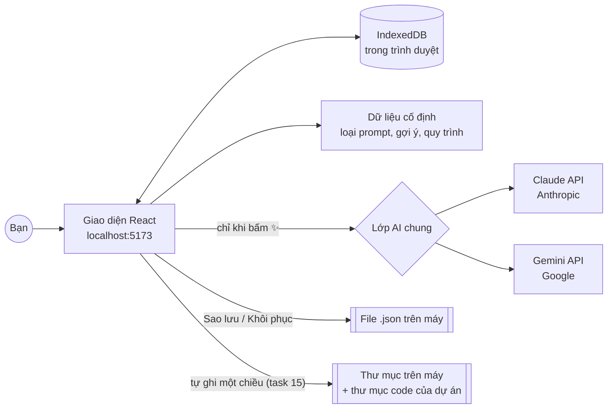

# ARCHITECTURE.md – Prompt Studio (Bước 4)

> Kiến trúc và công nghệ của app. Dựa trên `PRD.md` và các tài liệu trong `docs/`.
> Phiên bản: 1.0 – 18/10/2026. Phiên bản thư viện lấy từ npm vào ngày này.

## 1. Giải thích bằng lời đời thường

App giống một **cuốn sổ tay thông minh nằm hoàn toàn trên máy bạn**:

- **Giao diện** (React): các màn hình bạn bấm.
- **Ngăn kéo lưu trữ** (IndexedDB): nằm sẵn trong trình duyệt. Dự án, prompt, AGENTS.md, cài đặt đều cất ở đây. Không có máy chủ nào khác giữ dữ liệu của bạn.
- **Người trợ lý AI** (Claude, Gemini): chỉ được gọi khi bạn bấm ✨. Trình duyệt gửi thẳng câu hỏi tới Anthropic hoặc Google bằng API key của bạn, rồi nhận câu trả lời về.
- **Kho dữ liệu cố định** (đóng gói sẵn trong app): 18 loại prompt, bộ gợi ý, quy trình chuẩn, khung AGENTS.md, bảng thuật ngữ.



**Lưu ra thư mục (task 15).** Trên Chrome / Edge, người dùng chọn được một thư mục (File System Access API). Sau mỗi lần sửa
(chờ 0,6 giây), app ghi ra đó `du-lieu-prompt-studio.json` (không có API key) và mỗi dự án một thư mục Markdown; mỗi dự án
còn có thể ghi thẳng AGENTS.md / CLAUDE.md vào thư mục code. App chỉ ghi, không đọc lại – trừ nút "Nạp từ thư mục" khi đổi máy.
Code ở `src/lib/folder/` (`files.ts` dựng danh sách file, `fs.ts` đọc/ghi, `store.ts` nhớ thư mục, `sync.ts` điều phối) và
`src/features/folder/` (giao diện). Thư mục đã chọn được nhớ trong IndexedDB riêng `prompt-studio-folders`.

**Chi phí vận hành:** máy chủ 0 đồng, vì app chạy trên máy bạn. Bạn chỉ trả tiền AI theo số lần dùng (xem mục 9).

## 2. Công nghệ (tech stack)

| Phần | Công nghệ | Phiên bản | Vì sao chọn |
|---|---|---|---|
| Ngôn ngữ | TypeScript (strict) | 6.0 | Bắt lỗi trước khi chạy. AI viết TypeScript rất tốt. Dùng 6.0 theo mẫu Vite vì các công cụ đi kèm chưa hỗ trợ 7.0 |
| Kiểm tra cách viết code | oxlint + Prettier | 1.81 / 3.9 | Mặc định của mẫu Vite mới, chạy rất nhanh |
| Giao diện | React | 19.3 | Phổ biến nhất, nhiều tài liệu, dễ bảo trì |
| Công cụ build | Vite | 8.3 | Khởi động nhanh, cấu hình đơn giản |
| Định tuyến trang | React Router | 8.4 | Chuyển giữa các màn hình, nút Back hoạt động đúng |
| Kiểu dáng | Tailwind CSS | 4.3 | Làm đúng thiết kế doanh nghiệp + teal + sáng/tối bằng biến màu |
| Thành phần giao diện | shadcn/ui (dựa trên Radix) + lucide-react (biểu tượng) | mới nhất | Hộp thoại, tab, menu đạt chuẩn truy cập (bàn phím, trình đọc màn hình). Code được copy vào dự án nên sửa được |
| Lưu trữ | Dexie | 4.4 | Lớp bọc IndexedDB dễ dùng, có migration khi đổi cấu trúc |
| Kiểm tra dữ liệu | Zod | 4.6 | Kiểm tra phản hồi AI và file sao lưu trước khi dùng |
| Soạn Markdown | CodeMirror 6 (`@uiw/react-codemirror`) | 4.25 | Soạn AGENTS.md có tô màu cú pháp |
| Xem trước Markdown | react-markdown | 10.1 | Hiển thị AGENTS.md giống trên GitHub |
| So sánh trước/sau | diff (jsdiff) | 9.0 | Tô màu chỗ AI thay đổi trong hộp so sánh |
| Nén file .zip | fflate | 0.8 | Tải gói AGENTS.md + CLAUDE.md + .gemini/settings.json |
| AI – Claude | `@anthropic-ai/sdk` (SDK chính thức) | 0.135 | Có streaming, structured output, xử lý lỗi sẵn |
| AI – Gemini | `@google/genai` (SDK chính thức) | 2.30 | Tương tự cho Gemini |
| Kiểm thử đơn vị | Vitest + Testing Library | 5.0 | Chạy nhanh, cùng cấu hình với Vite |
| Kiểm thử luồng | Playwright | 1.64 | Tự bấm thử app như người dùng thật |

**Phím tắt** được tự viết bằng một hook nhỏ (`useHotkeys`), không cần thêm thư viện.

## 3. Cấu trúc thư mục

```
src/
  app/                  # khung app: router, layout (thanh bên thu gọn, header), theme sáng/tối, phím tắt
  features/
    projects/           # M1, M2 – danh sách dự án, chi tiết, hồ sơ dự án, thanh tiến độ
    task-prompt/        # M3, M4 – chọn loại prompt, bảng nhập, xem trước, ghép prompt
    wizard/             # M6 – AGENTS.md: hỏi đáp, nhập tự do, chỉnh sửa theo mục, kiểm tra chất lượng
    improve/            # M7 – cải thiện file/prompt có sẵn
    library/            # M8, M9 – thư viện, ghim, điền nhanh biến
    settings/           # M10 – API key, model, giao diện
    backup/             # sao lưu / khôi phục
    templates/          # M11 – giữ chỗ cho module Word/Excel (giai đoạn 2)
  components/           # thành phần dùng chung: DiffDialog (M5), PolishButton, Toast, Kbd...
  lib/
    ai/                 # AIProvider + claude.ts + gemini.ts + models.ts + errors.ts
    db/                 # schema Dexie, migration, hàm đọc/ghi
    prompts/            # dữ liệu cố định + meta-prompt cho từng tác vụ AI
    i18n/vi.ts          # toàn bộ chữ tiếng Việt trên giao diện
  types/                # kiểu dữ liệu dùng chung
tests/e2e/              # Playwright
```

## 4. Mô hình dữ liệu (lưu trong IndexedDB)

```ts
// Dự án (A1)
interface Project {
  id: string; name: string; description: string;
  profile: { goal: string; techStack: string; commands: string; structure: string; conventions: string; donts: string; notes: string };
  currentPhase: number;        // 0–10, thanh tiến độ theo quy trình chuẩn
  createdAt: number; updatedAt: number;
}

// Prompt đã lưu trong thư viện (A5). projectId = null nghĩa là "Dùng chung"
interface SavedPrompt {
  id: string; projectId: string | null;
  title: string; typeCode: PromptTypeCode;   // ví dụ 'SUA_LOI'
  body: string;                              // có thể chứa {{bien}} hoặc {{bien|mặc định}}
  formState?: PromptFormState;               // để "Mở trong bảng nhập" khôi phục đúng các ô đã tích
  tags: string[]; createdAt: number; updatedAt: number;
}

// AGENTS.md của một dự án (A2)
interface AgentsDoc {
  id: string; projectId: string;
  sections: { key: string; title: string; enabled: boolean; order: number; content: string; custom: boolean }[];
  updatedAt: number;
}

// Lịch sử phiên bản (dành sẵn cho B1)
interface Revision { id: string; docId: string; kind: 'agents' | 'prompt'; content: string; createdAt: number }

// Cài đặt: một bản ghi duy nhất
interface Settings {
  claudeKey?: string; geminiKey?: string;
  defaultProvider: 'claude' | 'gemini';
  claudeModel: string; geminiModel: string;
  language: 'vi-en' | 'vi' | 'en';
  theme: 'light' | 'dark'; sidebarCollapsed: boolean;
  pins: string[];              // id của SavedPrompt hoặc 'std:<mã>' cho prompt trong Quy trình chuẩn
  lastBackupAt?: number;
}
```

**Bảng Dexie phiên bản 1:**

```ts
db.version(1).stores({
  projects:  'id, updatedAt',
  prompts:   'id, projectId, typeCode, updatedAt, *tags',
  agentsDocs:'id, &projectId',
  revisions: 'id, docId, createdAt',
  settings:  'id',
});
```

Mỗi lần đổi cấu trúc phải tăng số phiên bản và viết migration (theo quy tắc trong AGENTS.md).

## 5. Dữ liệu cố định (không sửa trên giao diện)

| File trong `src/lib/prompts/` | Nội dung | Nguồn |
|---|---|---|
| `prompt-types.ts` | 18 loại prompt: tên, mô tả, vai trò mặc định, trường riêng, mẹo riêng | `docs/02`, `docs/04` |
| `suggestions.ts` | RB-01…12, CL-01…07, DR-01…07, TC-01…07 (nhãn + câu chuẩn) và bảng tích sẵn theo loại | `docs/04` |
| `standard-process.ts` | 11 giai đoạn và prompt mẫu (bộ sưu tập "Quy trình chuẩn") | `docs/01` |
| `agents-skeleton.ts` | Khung AGENTS.md 10 mục, câu hỏi Wizard, lựa chọn nhanh | `docs/03` |
| `glossary.ts` | Bảng thuật ngữ Việt ↔ Anh | `docs/04` |
| `build-prompt.ts` | Hàm **ghép prompt** từ bảng nhập theo khung 8 khối. Chạy trên máy, không cần AI | `docs/02` |
| `meta/*.ts` | Chỉ dẫn gửi cho AI ứng với từng tác vụ (mục 6) | — |

## 6. Lớp AI

### 6.1. Một "ổ cắm" chung cho mọi nhà cung cấp

```ts
interface AIProvider {
  id: 'claude' | 'gemini';
  testKey(key: string): Promise<{ ok: true; models: string[] } | { ok: false; error: AIError }>;
  // Trả về chữ theo từng đoạn (streaming). Có thể dừng bằng AbortSignal (nút "Dừng").
  streamText(req: AIRequest, signal: AbortSignal): AsyncIterable<string>;
  // Trả về JSON đúng schema (dùng cho chấm điểm, đề xuất có cấu trúc)
  generateJson<T>(req: AIRequest, schema: ZodType<T>, signal: AbortSignal): Promise<T>;
}
```

Giao diện chỉ làm việc với `AIProvider`. Muốn đổi hoặc thêm nhà cung cấp thì chỉ sửa trong `src/lib/ai/`.

### 6.2. Các tác vụ AI (chỉ chạy khi người dùng bấm nút)

| Tác vụ | Nút bấm | Đầu ra | Mức suy nghĩ (effort) mặc định |
|---|---|---|---|
| `polishField` | ✨ cạnh một ô | JSON: `{ rewritten, suggestions[] }` | low |
| `polishPrompt` | ✨ Trau chuốt toàn bộ | JSON: `{ improved, changes[], questions[], additions{block,text,reason}[] }` | medium |
| `agentsGenerate` | ✨ Tạo AGENTS.md (cuối Wizard) | Markdown theo 10 mục (streaming) | high |
| `agentsClassify` | ✨ Phân loại vào 10 mục | JSON: `{ sections: {key, content}[], missing[] }` | medium |
| `agentsRewriteSection` | ✨ Viết lại / Ngắn gọn hơn / Thêm ví dụ | JSON: `{ content, suggestions[] }` | low |
| `agentsCheck` | ✨ Kiểm tra lại bằng AI | JSON: `{ checks: {level, text, section}[] }` | medium |
| `improveAnalyze` | ✨ Phân tích (màn hình Cải thiện) | JSON: `{ scores{}, issues{level,text,fix}[] }` | high |
| `improveRewrite` | ✨ Viết lại theo các vấn đề đã chọn | JSON: `{ proposal, changes[] }` | high |

**AI theo ngữ cảnh (task 12A).** Mỗi lần bấm ✨, chỉ dẫn gửi AI được ghép từ các khối trong `src/lib/prompts/meta/context.ts`:
`<ho_so_du_an>` (hồ sơ + giai đoạn hiện tại), `<loai_prompt>` (mô tả, vai trò, lưu ý riêng, trọng tâm cố định trong
`src/lib/prompts/polish-focus.ts`), `<cac_o_khac>` (các ô đã điền) hoặc `<cac_muc_khac>` (các mục AGENTS.md khác).
Gợi ý thêm của AI (`suggestions`, `additions`) luôn tách riêng khỏi bản viết lại; người dùng tự tích chọn trong hộp so sánh.
Màn hình Cải thiện chia 2 bước: phân tích → người dùng chọn vấn đề → AI chỉ viết lại theo vấn đề đã chọn.

Một số kiểm tra **không cần AI** vì app tự làm được trên máy: đủ mục bắt buộc chưa, độ dài, lệnh có nằm trong khối code không, có chuỗi giống API key không. Nhờ vậy không tốn tiền.

Mọi kết quả JSON đều được kiểm tra bằng Zod. Nếu sai định dạng, app báo lỗi dễ hiểu và cho phép "Thử lại".

### 6.3. Cấu hình Claude

- **Model mặc định:** `claude-opus-5-5`, model mạnh nhất cho công việc hằng ngày. Trong Cài đặt có thể đổi sang `claude-sonnet-5-5` (rẻ bằng một nửa) hoặc `claude-haiku-5-5` (rẻ nhất). Danh sách model nằm trong `src/lib/ai/models.ts`, không viết cứng ở nơi khác.
- **Gọi từ trình duyệt:** dùng SDK chính thức với API key người dùng nhập và tùy chọn cho phép chạy trong trình duyệt. Tên chính xác của tùy chọn sẽ được xác minh với tài liệu SDK lúc viết code.
- **Suy nghĩ:** để mặc định (adaptive). Đặt `output_config.effort` theo bảng 6.2.
- **JSON có cấu trúc:** dùng `client.messages.parse()` với `output_config.format` (`zodOutputFormat`).
- **Streaming:** `client.messages.stream()`, kèm nút "Dừng".
- **Dự phòng khi bị từ chối:** bật `fallbacks: "default"` (beta `server-side-fallback-2026-07-01`). Nếu bộ lọc an toàn của Claude từ chối nhầm một yêu cầu, Anthropic tự chạy lại yêu cầu đó bằng model dự phòng. App luôn kiểm tra `stop_reason` trước khi đọc kết quả.

### 6.4. Cấu hình Gemini

- **Model mặc định: Gemini 3.8 Flash**, theo lựa chọn của chủ dự án.
- Khi bấm "Kiểm tra key", app lấy **danh sách model hiện có** từ Google. Nếu danh sách có Gemini 3.8 Flash thì app tự chọn. Nếu không có, app chọn bản Flash mới nhất và báo cho bạn biết. Tên model chỉ ghi ở một chỗ là `models.ts`, vì Google thường xuyên đổi tên model.
- Streaming và JSON có cấu trúc dùng SDK `@google/genai` (`responseSchema`).

### 6.5. Thông báo lỗi bằng tiếng Việt (`src/lib/ai/errors.ts`)

| Tình huống | Thông báo |
|---|---|
| Chưa nhập key | "Bạn chưa nhập API key Claude. Vào Cài đặt để nhập." |
| Key sai (401) | "API key Claude không hợp lệ. Vào Cài đặt để kiểm tra lại." |
| Quá giới hạn (429) | "Bạn đang gửi quá nhanh hoặc hết hạn mức. Đợi một chút rồi thử lại." |
| Lỗi máy chủ (5xx) | "Dịch vụ AI đang bận. Thử lại sau ít phút." |
| Mất mạng | "Không kết nối được Internet. Kiểm tra mạng rồi thử lại." |
| Bị từ chối (refusal) | "AI từ chối yêu cầu này. Thử diễn đạt lại nội dung." |
| JSON sai định dạng | "AI trả về kết quả không đúng định dạng. Bấm Thử lại." |

## 7. Bảo mật và quyền riêng tư

- Code chỉ gửi API key tới **api.anthropic.com** và **Google AI**, không gửi đi đâu khác. Không có analytics, không theo dõi người dùng.
- Key lưu trong IndexedDB của trình duyệt trên máy bạn. Đây là mức an toàn phù hợp cho app cá nhân chạy local. **Không dùng app trên máy tính công cộng.**
- **Sao lưu:** mặc định **không kèm API key**. Có ô tích "Kèm API key" nếu bạn muốn chuyển máy nhanh, kèm cảnh báo. File sao lưu nằm trong `.gitignore` để không bị đưa lên GitHub.
- Nội dung hiển thị từ AI được render an toàn: react-markdown không chạy HTML lạ.
- Dữ liệu người dùng dán vào được bọc trong thẻ `<log>`, `<code>`, `<tai_lieu>` khi gửi cho AI, để AI không nhầm dữ liệu với chỉ dẫn.

## 8. Kiểm thử

| Loại | Kiểm tra cái gì | Công cụ |
|---|---|---|
| Unit | Ghép prompt (`build-prompt`), điền biến `{{…}}`, kiểm tra AGENTS.md không cần AI, migration Dexie, chuyển lỗi sang tiếng Việt | Vitest |
| Component | Bảng nhập: tích gợi ý thì xem trước đổi theo. Hộp so sánh hiển thị đúng | Testing Library |
| E2E | 3 luồng chính trong `docs/05` (tạo dự án → AGENTS.md; tạo prompt → Copy; Thư viện → điền biến → Copy), sao lưu/khôi phục | Playwright |
| AI | **Không gọi API thật.** Dùng `MockProvider` trả kết quả mẫu cố định | Vitest |

## 9. Ước tính chi phí AI

Giá Claude lấy theo bảng giá Anthropic ngày 06/10/2026 (USD cho 1 triệu token). Token là đơn vị tính chữ của AI, mỗi token khoảng 3–4 ký tự.

| Model | Giá đầu vào | Giá đầu ra | Ước tính 1 lần "Trau chuốt toàn bộ"* |
|---|---|---|---|
| claude-opus-5-5 (mặc định) | $4 | $20 | khoảng $0,04 (~1.000đ) |
| claude-sonnet-5-5 | $2 | $10 | khoảng $0,02 (~500đ) |
| claude-haiku-5-5 | $0,10 | $0,50 | khoảng $0,001 (~25đ) |

\* Giả định khoảng 3.000 token gửi đi và 1.500 token nhận về. Thực tế có thể cao hơn vì AI còn "suy nghĩ" trước khi trả lời. Giá Gemini xem trên trang giá của Google. Tính năng B4 (phiên bản 1.1) sẽ hiện chi phí thật của mỗi lần gọi.

## 10. Rủi ro kỹ thuật và cách xử lý

| Rủi ro | Cách xử lý |
|---|---|
| Xóa dữ liệu trình duyệt thì mất hết | Nhắc sao lưu sau 7 ngày. Có khôi phục từ file. Task 15: tự ghi ra thư mục trên máy, "Nạp từ thư mục" để lấy lại |
| AI trả JSON sai | Structured output + kiểm tra bằng Zod + nút Thử lại |
| Tên model Gemini thay đổi | Lấy danh sách model từ Google khi kiểm tra key |
| Thư viện ra bản mới làm hỏng app | Ghi chính xác phiên bản trong `package-lock.json`. Chỉ nâng cấp khi chủ động yêu cầu |
| Đổi cấu trúc dữ liệu làm hỏng dữ liệu cũ | Migration Dexie + test migration |

## 11. Quyết định đã duyệt (18/10/2026)

1. ✅ **Thư viện mới:** Zod, diff, fflate, lucide-react đã được đồng ý.
2. ✅ **Model mặc định:** Claude `claude-opus-5-5`, Gemini **3.8 Flash**. Đổi được trong Cài đặt.
3. ✅ **Sao lưu mặc định không kèm API key.** Có ô tích để kèm.
