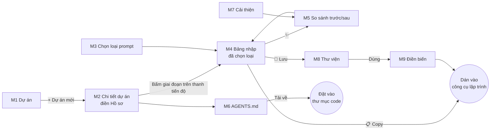

# Thiết kế: Màn hình và luồng sử dụng (Bước 3)

## 1. Bố cục chung

```
┌──────────────┬─────────────────────────────────────────────┐
│ Prompt Studio│  [Dự án đang chọn ▾]            [🔍 Tìm]     │
│              ├─────────────────────────────────────────────┤
│ 📁 Dự án     │                                             │
│ ✨ Tạo prompt│              Nội dung màn hình              │
│ 📄 AGENTS.md │                                             │
│ 🔧 Cải thiện │                                             │
│ 📚 Thư viện  │                                             │
│ ⚙️ Cài đặt   │                                             │
└──────────────┴─────────────────────────────────────────────┘
```
- Thanh bên trái dùng để chuyển chức năng. Trên điện thoại, thanh này chuyển thành menu ☰.
- **Ô chọn dự án** ở trên cùng: mọi chức năng đều làm việc theo dự án đang chọn.
  Có thêm lựa chọn "Không chọn dự án (dùng chung)".

## 2. Danh sách màn hình

| # | Màn hình | Thành phần chính | Tính năng PRD |
|---|---|---|---|
| M1 | **Dự án** (trang chủ) | Lưới thẻ dự án (tên, mô tả, giai đoạn hiện tại, lần sửa cuối) · Nút "+ Dự án mới" · Ô tìm kiếm · Banner nhắc sao lưu | A1, A8 |
| M2 | **Chi tiết dự án** | Thanh tiến độ 11 giai đoạn (bấm vào một giai đoạn để mở prompt mẫu tương ứng) · Hồ sơ dự án (form) · Các tài liệu đã tạo (AGENTS.md, prompt đã lưu) · Nút Nhân bản / Xóa | A1, A5 |
| M3 | **Tạo prompt – chọn loại** | 5 nhóm thẻ loại prompt · Ô tìm kiếm · Gợi ý "Giai đoạn hiện tại của dự án nên dùng: …" | A4 |
| M4 | **Tạo prompt – bảng nhập** | Bên trái: bảng nhập (các khối, gợi ý dạng nút chọn, nút ✨ ở từng ô) · Bên phải: xem trước prompt hoàn chỉnh · Thanh dưới: Ngôn ngữ · ✨ Trau chuốt toàn bộ · 💾 Lưu vào thư viện · 📋 Copy | A4 |
| M5 | **Trau chuốt – so sánh** (hộp thoại) | Bản cũ / bản mới đặt cạnh nhau, tô màu chỗ thay đổi · Câu hỏi AI cần bạn trả lời (nếu có) · Chấp nhận / Bỏ qua | A3, A4 |
| M6 | **AGENTS.md** | Chọn chế độ: Hỏi đáp / Nhập tự do / Chỉnh sửa · Danh sách 10 mục (bật/tắt, kéo thả) · Trình soạn thảo + xem trước · ✨ cho từng mục · Nút Kiểm tra · Tải về (.md / .zip có CLAUDE.md, GEMINI) | A2, A6 |
| M7 | **Cải thiện** | Ô dán hoặc tải file lên · Chọn loại nội dung (AGENTS.md / prompt) · Kết quả: điểm theo tiêu chí, danh sách vấn đề, bản đề xuất (mở M5) | A3 |
| M8 | **Thư viện** | Tab: Quy trình chuẩn · Của dự án · Dùng chung · Lọc theo thẻ · Thẻ prompt (Copy / Mở trong bảng nhập / Sửa) | A5 |
| M9 | **Điền biến** (hộp thoại) | Mỗi biến `{{…}}` là một ô nhập (đã điền sẵn giá trị mặc định) · Xem trước · Copy | A5 |
| M10 | **Cài đặt** | API key Claude / Gemini (ẩn/hiện, nút Kiểm tra) · Model mặc định · Ngôn ngữ mặc định · Sao lưu (tải .json) · Khôi phục (chọn file) · Xóa toàn bộ dữ liệu | A7, A8 |

## 3. Luồng chính



**Luồng 1 – Bắt đầu dự án mới:** M1 → "+ Dự án mới" → M2 điền hồ sơ → M6 Hỏi đáp → tải AGENTS.md.
**Luồng 2 – Viết prompt cho một việc:** M3 chọn "Sửa lỗi" → M4 điền (gợi ý đã tích sẵn) → ✨ → M5 chấp nhận → 📋 Copy.
**Luồng 3 – Dùng lại prompt:** M8 → chọn prompt → M9 điền biến → 📋 Copy.

## 4. Trạng thái cần thiết kế
- **Trống:** chưa có dự án hoặc chưa có prompt. Hiện hướng dẫn và nút hành động.
- **Đang tải:** chữ hiện dần theo luồng (streaming) + nút "Dừng".
- **Lỗi:** chưa có API key, key sai, mất mạng, hết hạn mức. Thông báo tiếng Việt kèm nút "Đi tới Cài đặt" hoặc "Thử lại".
- **Thành công:** thông báo nhỏ "Đã copy", "Đã lưu".

## 5. Phong cách
- Tối giản, nền sáng, một màu nhấn (xanh chàm). Có chế độ tối (mức B5).
- Chữ hiển thị tiếng Việt.
- Mockup tương tác (bấm thử được): https://claude.ai/artifact/5ehYGPek22DsNPgTX2Buan. Đăng nhập claude.ai để mở.
- Font chữ: Be Vietnam Pro (giao diện), JetBrains Mono (khung xem trước prompt).
